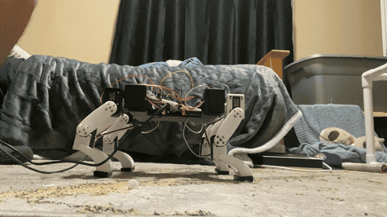
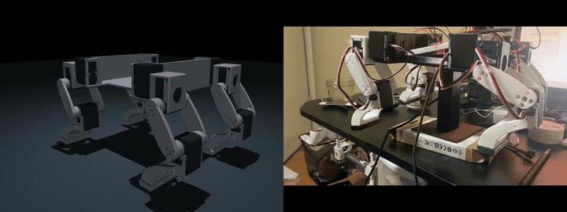

# Luca — RoboDog quadruped

A custom 3D-printed, 12-actuator quadruped built to investigate the path from
CAD and learned locomotion in simulation to calibrated physical motion.
This repository connects mechanical design, embedded telemetry, actuator
calibration, GPU reinforcement learning, and sim-to-real diagnostics.

**Current milestone:** slow walking in simulation and supported hardware
motion experiments. Full-body unsupported walking and closed-loop hardware
policy deployment are not yet validated.

[Sim-to-real comparison](#sim-to-real-evidence) ·
[Hardware and software](#hardware-and-software-stack) ·
[Calibration workflow](#calibration-and-hardware-workflow) ·
[Next steps](#next-engineering-milestones)

## Ground-contact diagnostic — October 30, 2026



A 10-second excerpt at original speed from the temporary prototype's ground-contact
test. This records experimental stepping and contact behavior; unsupported walking
and closed-loop hardware policy deployment are not yet validated.
[Full diagnostic recording](docs/sim-to-real/raw/supported-ground-diagnostic-20261030.mov)

## Simulation and supported hardware comparison



[Watch the full comparison](docs/sim-to-real/simulation-vs-real.mp4) ·
[Recording context](docs/sim-to-real/README.md)

The simulation body is fixed and the physical robot is supported. The clips
are not phase-synchronized: they illustrate joint motion, not measured tracking
accuracy or unsupported walking.

## Engineering overview

The project follows a measurement-driven loop: build the mechanism, establish
joint correspondence, compare commanded and measured motion, identify model
gaps, and evaluate revised controllers in simulation before expanding hardware
tests.

- **Mechanical integration:** Fusion assemblies, printable geometry, placement
  tools, and successive electronics-packaging revisions.
- **Calibration and telemetry:** explicit servo IDs, model-zero captures,
  signed encoder correspondence, conservative limits, and a read-only live
  mirror between physical joints and the simulation.
- **Learning and simulation:** a four-beat reference gait with small learned
  residuals; MuJoCo/Newton validation and a CUDA PPO pipeline covering physics,
  observations, rewards, normalization, GAE, and optimizer updates.
- **Transfer diagnostics:** supported joint-tracking logs, IMU bring-up,
  controlled COM/contact experiments, and a separate robust quasi-static
  crawl development track.

### Results and validation boundaries

| Area | Recorded result | What remains unproven |
| --- | --- | --- |
| Preserved walking benchmark | About **16.02 cm forward in 20 s**, six steps per leg, with no falls/sliding resets across three simulation trials | Broad robustness or physical walking; this is a limited historical benchmark |
| GPU training | CUDA pipeline tested locally and on an OSU H100 allocation; selected checkpoints retain normalization and source archives | Training throughput alone does not establish gait quality or transfer |
| Supported hardware transfer | Rear-left IDs 8/9 progressed through small-angle and full-amplitude replay; the faster 46.2 s trial completed with verified torque release | All-leg calibration, ground balance, or feedback-policy deployment |
| IMU bring-up | ESP32 readout identified an MPU6500-compatible device; stationary reference and gyro-bias estimate saved | Full sensor calibration, robot-axis alignment, and policy-ready body-state estimation |
| Robust crawl | Separate simulation preset and scenario curriculum implemented | A validated robust-crawl result on the final robot |

The walking benchmark is documented in the [October 26 status snapshot](docs/STATUS.md)
and [preserved policies](policies/README.md). Later successor-policy diagnostics
have different conditions and should be read separately.

## Hardware and software stack

| Layer | Components and role |
| --- | --- |
| Mechanism | Custom printed quadruped, 12 STS3215 bus servos; Fusion snapshots and STL/STEP assets in [CAD](cad/README.md) |
| Servo bus | Waveshare Bus Servo Adapter (A), 12 V servo supply; historical PC serial tools and current ESP32 telemetry workflow |
| Embedded controller | NodeMCU ESP32S; servo UART on GPIO17 TX / GPIO16 RX; USB CSV telemetry normally on COM7 at 115200 baud |
| Inertial sensing | MPU6500-compatible device at I2C address 0x68, using GPIO21/22; [bring-up and reference capture](hardware/imu/README.md) |
| Calibration tools | Python viewers, timestamped zero/direction/limit records, encoder-to-model conversion, and read-only live mirroring |
| Simulation | MuJoCo robot model; Newton GPU physics and validation tools |
| Learning | PPO with a 60-value observation contract and 12 actions; 50 Hz control with learned residuals limited to about 2° in the preserved v7 controller |
| Reproducibility | Python 3.12, pinned CPU/CUDA dependency sets, W&B run tracking, frozen policy sources and normalization backups |

Final chassis, battery, power distribution, and onboard-compute integration
remain in development. Packaging CAD is revision-specific and does not
automatically update the simulation's mass, inertias, or joint geometry.


## Calibration and hardware workflow

Start with the [current hardware sequence](hardware/GETTING_DOG_RUNNING.md).
The newer ESP32 calibration records and older PC-driven rear-left replay
describe different stages of the prototype; historical successful motion
does not make the new frame ready for full-body replay.

1. **Confirm identity and zero pose.** Use the current joint map and
   [zero-point procedure](hardware/ESP32_ZERO_CHECK.md). Approximate model zeros
   live in [zero-points-current.json](hardware/calibrations/zero-points-current.json);
   they are not generic factory centers.
2. **Capture directions and conservative endpoints.** Follow the
   [ESP32 direction/limit checker](hardware/ESP32_DIRECTIONS_LIMITS.md), preserving
   timestamped evidence and the source-zero hash. Manual endpoint captures
   cover the checked neighboring poses, not every combined-leg configuration.
3. **Verify correspondence without commands.** Use the
   [read-only live mirror](hardware/READ_ONLY_LIVE_MIRROR.md), moving one
   torque-off joint by hand at a time. Confirm all 12 joints match the model.
4. **Review before powered replay.** Reconcile measured signs with command
   conversion and review non-wrapping limits and interference. The current
   telemetry CSV sketch is not an armed command transport; the ESP32 path still
   needs explicit arm/start/stop, fresh feedback, bounds, and a watchdog.
5. **Expand supported tests gradually.** Begin with one joint or one supported
   leg, record target/encoder response, and verify stop/release behavior.
   See the [historical supported replay](hardware/SUPPORTED_REPLAY.md) and
   [deployment handoff](hardware/SIM2REAL_HANDOFF.md) for context.

Current physical IDs, ordered hip roll / hip pitch / knee pitch:

| Leg | IDs |
| --- | --- |
| Front left | 4 / 5 / 6 |
| Front right | 1 / 2 / 3 |
| Rear left | 7 / 8 / 9 |
| Rear right | 11 / 10 / 12 |

The historical rear-left neutral is hip ID 8 = 1677 and knee ID 9 = 1572
ticks. Keep that record distinct from new-frame model-zero captures.
The receive-only tools do not arm motors or disable torque.

## Sim-to-real evidence

| Evidence | Engineering value | Interpretation boundary |
| --- | --- | --- |
| [Side-by-side animation and video](docs/sim-to-real/README.md) | Public visual comparison of successor-policy joint targets and supported robot motion | Fixed simulated body, supported robot, unaligned gait phases; no tracking metric |
| [Rear-left tracking records](reports/sim2real/README.md) | Commanded/measured ticks, error, temperature, and completion/release status for IDs 8/9 | Supported open-loop replay; no balance or world-motion measurement |
| [October 30 ground-contact diagnostic](docs/sim-to-real/raw/supported-ground-diagnostic-20261030.mov) | Records front-foot contact behavior on the temporary prototype | Diagnostic footage, not a validated walking demonstration |
| [COM/contact study](runs/com-dynamics-study/README.md) | Frozen policy and normalizer evaluated with identical three reset seeds across mass/COM scenarios | Simulation-only sensitivity study with provisional actuator/contact models |

In the COM study, the rear-biased case reduced front normal force by about
22% and triggered sliding resets in all three trials. A forward shift increased
front force but did not by itself produce a robust gait. The model has a lumped
base mass and no separate installed battery model, so this supports a hypothesis
about front-foot unloading rather than proving its physical cause.

That finding motivates the [quasi-static robust-crawl track](simulation/rl/QUASISTATIC_ROBUST_CRAWL.md):
a 5 s cycle, 5 mm/s command, 10 mm reference stride, 12 mm lift, and a 16% swing
fraction that schedules one swing leg and three stance legs. Its curriculum
varies COM, friction, and controller-response proxies across consecutive
simulation scenarios. Those proxies are not measured STS3215 dynamics, and
this workflow is not yet a hardware-validated policy.

## Next engineering milestones

1. **Close calibration gaps:** verify all 12 directions in the live mirror,
   capture conservative endpoints, reconcile historical mappings, and review
   a canonical calibration before generating new motion commands.
2. **Identify actuator response:** measure supported step-response tracking,
   latency, and rate behavior; use the measurements to replace provisional
   controller-response ranges.
3. **Model the final assembly:** measure installed component masses and
   locations, separate frame/electronics/battery inertias, and re-evaluate COM
   and contact sensitivity.
4. **Evaluate crawl robustness:** test saved candidates across the corrected
   model and declared COM/friction/actuator scenarios, reporting progress,
   slip, pitch, and failures alongside the test conditions.
5. **Complete the hardware feedback path:** align and calibrate the mounted
   IMU, supply the policy's body-state observations, and implement guarded
   command transport before a staged supported-to-ground progression.

## Explore the repository

| Folder or guide | Contents |
| --- | --- |
| [cad](cad/README.md) | Mechanical snapshots, build tools, printable assets and revision context |
| [hardware](hardware/README.md) | Servo mapping, calibration history, telemetry, IMU and supported replay |
| [simulation/mujoco](simulation/mujoco/README.md) | Robot model, scripted previews and model checks |
| [simulation/rl](simulation/rl/README.md) | Controller contract, CPU/Newton validation, CUDA PPO and evaluation |
| [policies](policies/README.md) | Selected milestones with weights, normalization and exact training sources |
| [reports/sim2real](reports/sim2real/README.md) | Representative supported tracking records |
| [runs/com-dynamics-study](runs/com-dynamics-study/README.md) | Controlled COM/contact comparison and limitations |
| [HPC guide](docs/HPC.md) | Environments, continuation and checkpoint handling |

## Local setup and simulation playback

Use Python 3.12. From the repository root:

```bash
python -m venv .venv
# Activate the environment for your shell.
python -m pip install -r requirements-rl.txt
python -m pytest -q
```

`pytest.ini` selects simulation and mock hardware tests; it does not run motor
experiments. Read the hardware guide before executing standalone hardware
scripts, which may contain serial actions or historical hardcoded IDs.

For a compatible NVIDIA system, use the separate pinned
`requirements-cuda.txt` environment and follow [CUDA training](simulation/rl/CUDA_TRAINING.md)
and the [HPC guide](docs/HPC.md). In a Newton-capable environment:

```bash
python simulation/rl/play.py policies/best-distance --source simulation/mujoco
```

Preserve normalization with weights and keep new runs separate from milestone
backups.

## Asset and backup scope

Git contains selected code, CAD exports, calibration history, representative
measurements, and policy/source backups. Full raw training runs, environments,
caches, transfer archives, and containers are excluded. Unsaved Fusion state
and unexported remote HPC files are outside this backup.

No license has been selected. Third-party geometry retains its ownership and terms.

