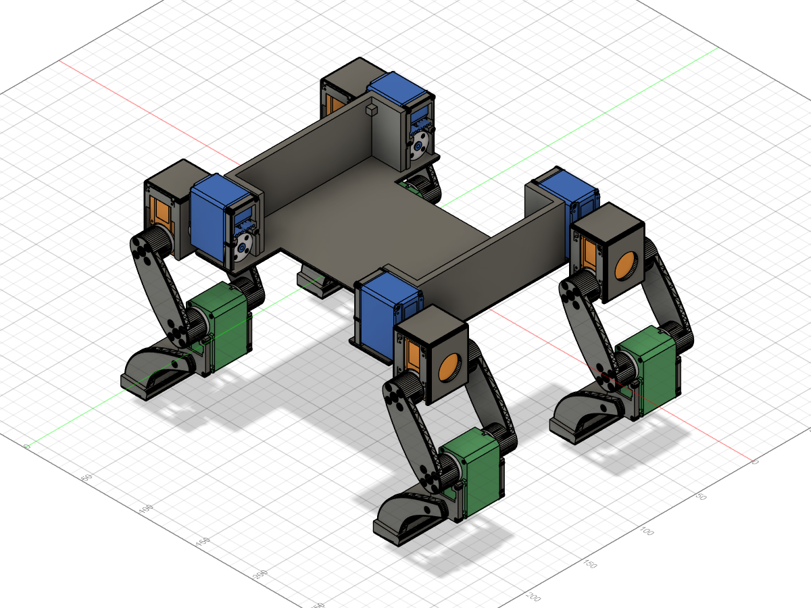

# RoboDog

A custom, 3D-printed quadruped with 12 STS3215 bus servos. Mechanical design, physical calibration, and walking simulations live here; reinforcement learning in Isaac Lab / Newton is the next stage.



## Project map

| Folder | Contents |
| --- | --- |
| [cad/](cad/README.md) | Fusion assemblies, STL/STEP sources, placement data, and CAD tools |
| [hardware/](hardware/README.md) | Servo IDs, neutral poses, calibration, and serial utilities |
| [simulation/mujoco/](simulation/mujoco/README.md) | Model, gait preview, and contact-dynamics experiment |
| [docs/](docs/STATUS.md) | Current limitations, next steps, and HPC setup notes |

## Current state

- Twelve servo IDs have recorded assignments. Rear-right hip IDs differ from the other legs; use the [ID map](hardware/servo_id_map.md).
- Latest Fusion export: [Knee Housing Connections](cad/RoboDog%20-%20Knee%20Housing%20Connections.f3d). The four knee housings belong to the knee-pitch/boot groups; their output discs belong to the upper links.
- The front-left knee test exposed a pivot near the hip. Knee pivot correction and motion validation remain open.
- MuJoCo has a hand-designed kinematic preview and a free-base dynamics experiment. No trained RL policy or validated hardware gait is included.
- Isaac Lab / Newton ran on OSU HPC. Remote project files and containers are outside this local backup; see [HPC notes](docs/HPC.md).

## Simulation quick start

From the repository root, using Python 3.12:

```sh
python -m venv .venv
# Activate .venv using your shell's activation command.
python -m pip install -r requirements.txt
python simulation/mujoco/check_model.py
python simulation/mujoco/view_dog_walk.py --viewer --lift-mm 10
```

Rebuild with `python simulation/mujoco/build_mujoco_v2.py`. It uses saved placement data that has not been regenerated from the latest Fusion edit. The preview image above also predates that edit.

## Hardware

Read the [hardware guide](hardware/README.md) before running tools. Several historical scripts command motion immediately. Verify ports and IDs, secure the robot, and keep its legs clear. Recorded limits depend on other joint positions and are provisional.

See [project status](docs/STATUS.md) for remaining work and backup boundaries. No license has been selected; third-party geometry retains its original ownership and terms.
