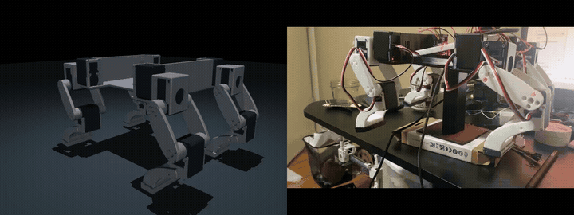

# Luca

Luca is a 12-DOF, 3D-printed quadruped developed to learn the full
sim-to-real workflow: CAD, MuJoCo/Newton simulation, PPO reinforcement
learning, an ESP32-S3 servo/IMU receiver, and a Raspberry Pi ROS 2 bridge.

## Start here

- [Project showcase](docs/SHOWCASE.md)
- [Current project status](docs/STATUS.md)
- [Current CAD and print parts](cad/README.md)
- [Hardware safety and calibration](hardware/GETTING_DOG_RUNNING.md)
- [ROS 2 IMU bridge](ros2/luca_imu_bridge/README.md)
- [Current MuJoCo model](simulation/mujoco/p2s/README.md)
- [P2S H100 quasi-static crawl](simulation/p2s_crawl/README.md)
- [Policy catalog](policies/README.md)
- [Sim-to-real evidence](docs/sim-to-real/README.md)

## Repository layout

| Folder | Purpose |
| --- | --- |
| `cad/` | Active P2S chassis, enclosure, electronics mounting and test-stand files. |
| `hardware/` | ESP32-S3 firmware, calibrated joint data, safe replay and diagnostic tools. |
| `ros2/` | Raspberry Pi ROS 2 packages. The IMU bridge is telemetry-only. |
| `simulation/` | MuJoCo/Newton model and RL training/evaluation source. |
| `policies/` | Selected PPO checkpoints and their normalization/configuration files. |
| `docs/sim-to-real/` | Representative simulation-versus-supported-hardware media. |
| `revision_one_oz/` | Current power-distribution PCB source and ordering reference. |

## Current boundary

The chassis/electronics mass distribution remains provisional. Existing
policies and simulation results are useful references, not approval for
unsupported dynamic walking. The active engineering priority is reliable
telemetry, calibration, slow supported testing, and a robust crawl policy.

## Sim-to-real showcase

The left panel is the policy joint-target reference; the right panel is Luca
following that reference during a supported hardware test. See the
[showcase](docs/SHOWCASE.md) for videos, evidence boundaries, and the current
engineering milestones.
