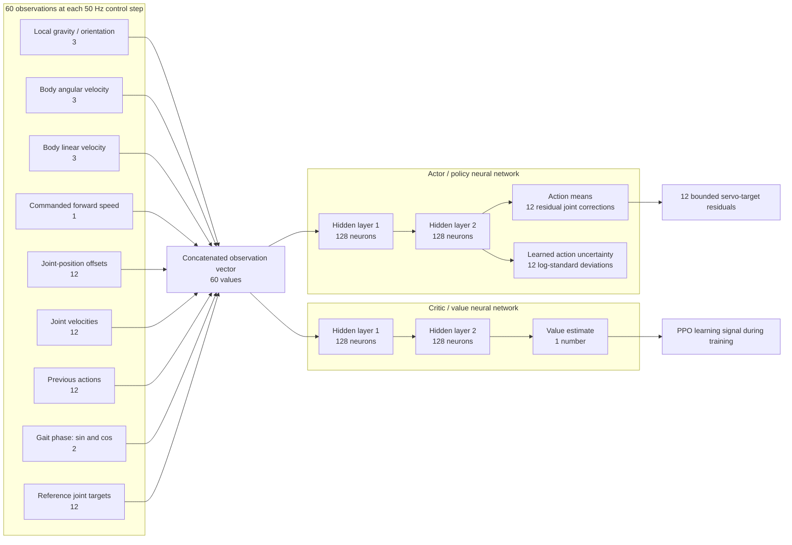

# Luca PPO neural-network architecture

Luca's saved PPO checkpoints use an actor–critic multilayer perceptron (MLP).
Both networks receive the same 60-value observation vector; they then have
their own two hidden layers of 128 neurons. This is the `[128, 128]` network
architecture reported by Stable-Baselines3.

## What it means

- The **actor** decides a small residual correction for each of the 12 joint
  targets around the programmed gait reference.
- The **critic** estimates the expected return of the current state. PPO uses
  it during training to determine whether sampled actions were better or worse
  than expected.
- `128, 128` means two fully connected hidden layers with 128 neurons each;
  it does not mean 128 physical sensors or actuators.
- The saved `best-distance` and `latest-long-run` networks each contain
  **50,329 trainable parameters**.

The current hardware does not yet supply every policy input directly. In
particular, body linear velocity needs an estimator for closed-loop deployment.
Supported replay is currently an open-loop joint-target test, not live policy
inference on Luca.
