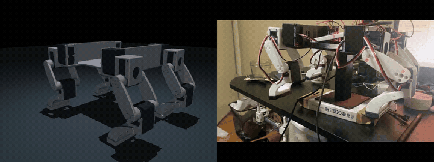

# Luca project showcase

Luca is a self-built quadruped robotics project spanning mechanical design,
simulation, reinforcement learning, embedded control, and ROS 2 telemetry.

## Sim-to-real replay

- [Side-by-side MP4](sim-to-real/simulation-vs-real.mp4)
- [Simulation reference MP4](sim-to-real/simulation-reference.mp4)
- [Supported ground-contact diagnostic](sim-to-real/raw/supported-ground-diagnostic-20261030.mov)

## Current accomplishments

- Designed a 12-DOF printed quadruped and current P2S chassis/electronics
  packaging in CAD.
- Built a MuJoCo/Newton simulation workflow and trained PPO neural-network
  policies using an H100 GPU allocation.
- Implemented an ESP32-S3 receiver for 12 STS3215 bus servos, safe supported
  replay, encoder telemetry, and MPU6500-compatible IMU readout.
- Added a Raspberry Pi ROS 2 Jazzy bridge that publishes raw IMU telemetry on
  `/imu/data_raw` without issuing servo commands.

## Honest current stage

The comparison is a supported joint-reference replay, not independent walking.
The current hardware mass distribution is temporary while the final battery,
power distribution, Pi and enclosure placement are being completed. The next
phase is IMU calibration, final mechanical calibration, and robust
quasi-static-crawl simulation across multiple mass distributions.
