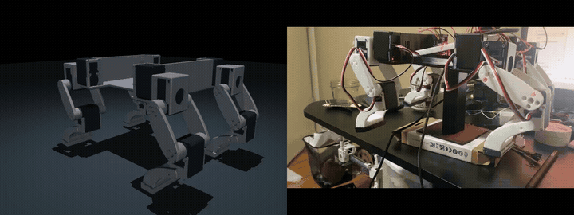

# Simulation and supported robot comparison

[Watch the side-by-side MP4](simulation-vs-real.mp4) ·
[Watch the simulation reference](simulation-reference.mp4) ·
[View the project showcase](../SHOWCASE.md)

The simulation reference visualizes the saved `faad4x73` successor policy's joint targets from the selected overnight checkpoint. The simulated body is fixed in place: this is a joint-reference visualization, not a recorded physics rollout or a measurement of walking speed. The real robot is supported, and the two clips begin at their respective starts rather than at a precisely aligned gait phase. They do not demonstrate unsupported walking or establish tracking accuracy.

The physical video is silent in the comparison, and source camera/location metadata is removed. The simulation video is also available separately as [simulation-reference.mp4](simulation-reference.mp4).

## Ground-contact diagnostic

[Supported ground-contact diagnostic, October 30 2026](raw/supported-ground-diagnostic-20261030.mov)
is retained as raw project evidence from the current temporary prototype. It is
not a demonstration of a validated walking policy. The front-foot contact issue
seen during this stage motivated the separate COM/robust quasi-static-crawl
simulation track.
